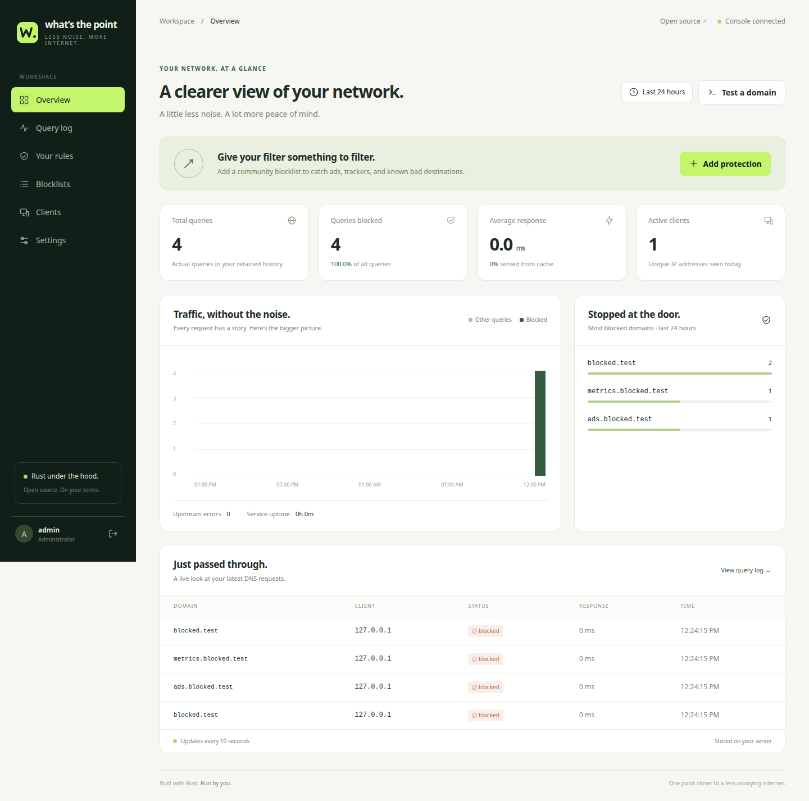

<p align="center"></p>
<h1 align="center">what’s the point</h1>
<p align="center"><strong>Enterprise-shaped web filtering. An unreasonable interest in whether it works.</strong></p>
<p align="center">
  <a href="https://github.com/CharlesDerek/whatsthepoint/actions/workflows/ci.yml"></a>
  <a href="LICENSE"></a>
  
  
</p>
<p align="center">
  <a href="#platform-overview">Platform</a> ·
  <a href="#quick-start">Quick start</a> ·
  <a href="#deployment">Deployment</a> ·
  <a href="#security-and-governance">Security</a> ·
  <a href="#validation-and-release-status">Validation</a> ·
  <a href="#documentation">Documentation</a>
</p>

---

## Executive summary

**We’re not in this to make a dollar. We’re here to find the point.**

The lost one. The one where tools work, settings mean something, and somebody knows how the thing actually works. Or at least somewhat does. Apparently this now qualifies as a product vision.

According to our entirely unreviewed market research, every web filtering tool is required to have “point” in its name. Endpoints. Checkpoints. Proof points. At some point, we seem to have misplaced the actual point. So we added the word to the name. Maybe we’d find it. If that fails, we’ll capitalize it, put it in a quadrant, and schedule a discovery call to discover what the software does.

**What’s the Point** is self-hosted web filtering with a Rust DNS resolver, a Chrome/Chromium/Edge extension, desktop account identity, and a privileged endpoint agent. One portal manages DNS rules, browser policies, and signed device network policies. Your configuration lives in SQLite. Your subscription renewal lives nowhere.

The enterprise layout is here so procurement can relax. The source code is here so everyone else can check.



> **Release status — v0.2:** Browser and endpoint enforcement are implemented. Linux kernel enforcement has been tested locally. Windows/macOS adapters pass Rust cross-checks; native firewall acceptance and production publisher signing remain outstanding. A platform column is not a test result, even when the table is very attractive.

## Platform overview

| Layer | What it does | Where it runs |
| :--- | :--- | :--- |
| **Management portal** | Rules, desktop profiles, device enrollment, policy diagnostics, activity, quarantine, and restore | Self-hosted Rust service with local SQLite storage |
| **DNS filtering** | Domain/subdomain rules, blocklists, encrypted upstream resolution, caching, and alias checks | Linux, Windows, or macOS server |
| **Browser protection** | URL checks, ordered organization/group/profile rules, page categories, and a sanitized reader | Chrome, Chromium, and Edge |
| **Desktop identity** | Reports the launching OS account’s Unix UID or Windows SID | Native companion on the desktop |
| **Endpoint enforcement** | Signed network allowlists, firewall repair, policy expiry, quarantine, and rollback | Privileged agent using nftables, Windows Firewall, or macOS PF |
| **Distribution** | Artifact verification, CRX3 packaging, and native signing workflows | Your build infrastructure and signing identities |

Three enforcement layers, one portal, and an unusual commitment to explaining which part is doing what. We considered calling all of it “the engine,” but then someone might ask where the engine is.

### Policy and inspection

- **Ordered browser rules:** organization → group → desktop profile, then priority and rule ID. The first match wins; DNS blocks remain a baseline.
- **Page controls:** domain and URL-path matching, explicit category rules, inferred categories from configurable domains/phrases, and explainable verdicts.
- **Navigation checks:** a Manifest V3 gate checks top-level GET destinations and redirects; an unavailable portal pauses navigation.
- **Sanitized reading:** text-only rendering, checked links, tracking-parameter removal, and category checks before reader display.
- **Desktop profiles:** enrollment, group assignment, OS account binding, credential rotation, and revocation.

Category inference uses configurable rules. We have resisted describing a phrase match as a sentient threat intelligence platform. Investor relations is taking it badly.

### Network and endpoint controls

- **DNS transport:** UDP and TCP, IPv4/IPv6 listeners, explicit client CIDR allowlists, and encrypted upstream DNS with certificate validation and no plaintext fallback.
- **DNS decisions:** international domain normalization, parent/subdomain rules, explicit allow overrides, and CNAME/HTTPS/SVCB target checks.
- **Operational continuity:** bounded TTL caching with live policy checks, upstream failover, atomic imports, and last-good-copy blocklist retention.
- **Managed feeds:** optional [HaGeZi](https://github.com/hagezi/dns-blocklists) Light and Normal lists with daily refresh.
- **Device policies:** versioned Ed25519 signatures, approved DNS servers, IP:port destinations, physical interfaces, status reports, and quarantine/restore.
- **Enforcement supervision:** protected local state, rollback protection, firewall drift repair, and management-only quarantine when policy expires.

Endpoint enforcement is a strict destination allowlist. General browsing requires approved destinations or a controlled web gateway. A VPN or proxy hosted on an explicitly approved destination is still reachable. Putting “zero trust” in a heading would not change that packet.

### Operations and administration

The responsive console provides traffic metrics, query history, policy diagnostics, client activity, and administrator audit history. Storage and retention stay local. There is no frontend build step for the shipped console, no default administrator password, and no subscription required to discover which button applies a rule.

## Quick start

Three commands. No account executive has to qualify whether you’re ready to run a binary.

Install a current stable Rust toolchain (minimum **1.91**; dependency updates may raise that requirement), then:

```sh
cargo build --release --locked
./target/release/wtp init
./target/release/wtp serve
```

On Windows, use `.\target\release\wtp.exe` in place of `./target/release/wtp`.

Open **http://127.0.0.1:8080**, sign in as `admin` with the password you chose, then open **Blocklists → Add protection**. The initial policy contains only `blocked.test`, a reserved test domain. Community feeds download only when you install them. We decided “installed” and “protecting you from everything” should remain different statements.

The default DNS listener is **127.0.0.1:5354**, so you can try the resolver without administrator privileges:

```sh
dig @127.0.0.1 -p 5354 blocked.test       # NXDOMAIN: blocked locally
dig @127.0.0.1 -p 5354 example.com        # Resolved through encrypted upstream DNS
dig +tcp @127.0.0.1 -p 5354 blocked.test  # TCP gets to participate too
```

These commands test the resolver. To filter a device’s normal DNS traffic, configure port 53 and point the device/router at it. Follow the [platform setup and rollback guide](docs/operations.md).

## Deployment

### Browser protection

In **Browser protection**, enroll a desktop profile and copy its token. For development, load **extension/** as an unpacked extension, then enter the portal origin and token. Native OS identity requires registering `wtp-native`; enforced deployments require administrator-managed browser policies.

Create rules and categories in the portal, then use **Test a page** to preview a profile’s decision. The [browser deployment guide](docs/browser-protection.md) covers setup, rule precedence, managed installation, and inspection limits.

Unpacked development installation is removable by its user. We have not reclassified that as “user-empowered tamper resistance.”

### Endpoint enforcement

On an HTTPS portal, open **Endpoints → Enroll an endpoint**, download the enrollment file, fetch and review the signed firewall plan, and install the matching privileged agent. Keep a recovery console available during first activation.

Follow [endpoint installation and rollback](docs/endpoint-enforcement.md) and [signed distribution](docs/release-signing.md). The agent uses existing OS kernel firewalls. The browser extension does not acquire administrator privileges through the sheer confidence of its product description.

### Service configuration

```sh
./target/release/wtp config > wtp.toml
./target/release/wtp --config wtp.toml --data-dir data serve
```

Use the same `--data-dir` for `init`, `serve`, `check`, and `reset-password`. Unknown TOML options fail startup. A typo should produce an error, not an exciting new interpretation of your security policy.

<details>
<summary><strong>Example configuration and network deployment notes</strong></summary>

```toml
dns_bind = "127.0.0.1:53"
http_bind = "127.0.0.1:8080"
public_origin = "http://127.0.0.1:8080"
allowed_clients = ["127.0.0.0/8", "::1/128"]
cache_entries = 10000
query_log = true
retention_days = 7
max_log_entries = 100000

[[upstreams]]
url = "https://dns.quad9.net/dns-query"
bootstrap = "9.9.9.9:443"

[[upstreams]]
url = "https://dns.quad9.net/dns-query"
bootstrap = "149.112.112.112:443"
```

The default [Quad9 secure service](https://quad9.net/service/service-addresses-and-features/) also blocks known threats and validates DNSSEC upstream. Local allows cannot override that provider’s blocks. WTP trusts the configured resolver’s validation; it is not an independent DNSSEC validator.

For LAN use, bind DNS to the server’s LAN IP, add the intended subnet to `allowed_clients`, and restrict firewall access accordingly. Configure IPv6 deliberately; an IPv6 wildcard does not imply IPv4 support on every OS. Each instance supports one DNS listening address.

For a remote portal, keep its listener on loopback, terminate TLS with a reverse proxy, and set `public_origin` to the exact HTTPS origin without a trailing slash. See [remote console setup](docs/operations.md#remote-console).

Local configuration, databases, logs, build artifacts, and agent instruction/context files are gitignored.

</details>

## Policy behavior

A policy engine should be explainable without a three-hour enablement session and a diagram containing seventeen clouds.

DNS evaluates requests in this order:

1. An allow rule on the requested domain or any ancestor wins.
2. Otherwise, the nearest matching block rule or blocklist entry blocks it.
3. Otherwise, forward to the configured encrypted upstream.
4. Apply the same policy to CNAME, HTTPS, and SVCB targets in the returned answer.

`example.com` matches `a.example.com`, but never `notexample.com` or `example.com.evil.net`. Both bare domains and `*.example.com` include the apex. Allowing a parent allows its descendants, even if a child has a block rule. An unrelated blocked alias still requires its own allow rule.

```sh
./target/release/wtp check sub.blocked.test
```

The CLI and **Test a domain** explain local rules; they do not query upstreams or discover aliases. Changes apply to the next request reaching WTP. Existing DNS caches and open connections can outlive a DNS rule change. Browser policy precedence and endpoint connection enforcement have their own documented behavior.

## Security and governance

The security model is written down. This has proved more useful than printing a padlock next to the word “military.”

| Area | Implemented behavior | Boundary |
| :--- | :--- | :--- |
| **Administrator access** | Argon2id passwords, hashed sessions, HttpOnly/SameSite cookies, CSRF protection, Host/Origin checks, login throttling | One locally initialized administrator; RBAC, SSO, and MFA are not implemented |
| **Browser inspection** | URL gating, visible-text categories, and a restricted reader | Normal interactive pages are inspected after loading; this is not pre-execution malware isolation |
| **Device identity** | Native Unix UID / Windows SID reporting and profile binding | Account reports are not hardware attestation |
| **Network enforcement** | Signed destination/interface allowlists, expiry, quarantine, and firewall repair | Local administrators/root can remove controls; approved destinations can carry tunnels |
| **Data handling** | Local SQLite configuration/history, bounded retention, optional query logging | Operators control storage permissions, backups, and disk protection |
| **Release integrity** | Independent artifact verification, CRX3 checks, native signing workflows | Trusted publisher credentials and production distribution must be supplied and validated |

The console itself has no analytics, remote JavaScript, external fonts, or third-party requests. The extension sends checked URLs, category IDs, and optional OS identity to your portal; normal page text stays in the extension. Browser history omits query strings and fragments, though paths may still contain sensitive information. DNS queries go to your configured resolver, and installed feeds download from GitHub.

Set `query_log = false` to stop recording new DNS and browser history. Existing DNS history can be cleared separately; browser history follows retention. Logs are bounded by age and count, with minute-by-minute pruning. Under load, queued events can be dropped. The dashboard is operational telemetry, not an invoice generator with unusually strong opinions about DNS.

Read [SECURITY.md](SECURITY.md) before deployment. WTP does not silently change system DNS, firewalls, browser policies, or services; privileged endpoint activation is explicit.

## Validation and release status

“Works on my machine” is a useful beginning. We’ve added the part where we say which machine.

| Component | Evidence available | Still required |
| :--- | :--- | :--- |
| **Rust service and policy engine** | 27 passing local Rust tests covering DNS, authentication, APIs, identity, signatures, and policy state | Independent security review and performance benchmarks |
| **Portal and extension** | 3 JavaScript tests and 4 Chromium integration tests, including HTTPS enrollment, navigation blocking, categories, reader isolation, and revocation | Broader browser/version and managed-fleet acceptance |
| **Linux endpoint** | Real isolated-kernel IPv4/IPv6, DNS restrictions, signature rejection, drift repair, expiry, quarantine, TLS retrieval, and rollback tests | Deployment-specific service/reboot and fleet acceptance |
| **Windows and macOS endpoint** | Rust cross-checks; PowerShell scripts parse; native CI checks are configured | Native firewall activation, live-connection behavior, reboot, and rollback acceptance |
| **Distribution** | Disposable-key artifact/CRX3 signing and independent corruption rejection | Production certificates, Apple notarization, store/feed publication, and managed update acceptance |

The native CI matrix targets Linux x64, Windows x64, macOS Apple Silicon, and macOS Intel. A configured job is not a claim that every deployment scenario has passed. Green badges are lovely; evidence is less decorative.

### Run the checks

```sh
cargo test --workspace --locked
cargo fmt --check
cargo clippy --workspace --all-targets --locked -- -D warnings

npm ci
npx playwright install chromium
npm run check
npm test
```

Browser tests use disposable instances, credentials, websites, and Chromium profiles. They cover desktop/mobile rendering and real enforcement behavior without using your normal data directory. The console is plain HTML/CSS/JavaScript embedded at compile time; Node is needed for these tests, not the deployed service.

For endpoint kernel tests with Docker available:

```sh
python3 scripts/linux-integration.py
```

That suite creates isolated containers and an internal network. It does not change the host firewall. The [endpoint guide](docs/endpoint-enforcement.md#validation) records the coverage and the native tests still needed. For an optional live DNS/feed check after a release build, run `python3 scripts/smoke.py --feed`.

### Build artifacts and signing

CI produces `wtp`, `wtp-native`, and `wtp-agent`. Tag builds create **unsigned development archives** with SHA-256 checksums. The separate signing workflow supports Ed25519 archive signatures, Windows Authenticode, and Apple signing/notarization using operator-provided identities. See [release signing](docs/release-signing.md).

Checksums are not publisher signatures. We could put both under “enterprise trust,” but then somebody might know how they work.

## Roadmap

The next points are native Windows/macOS enforcement acceptance, production signing and extension distribution, automatic binary updates, schedules, RBAC/SSO, stronger identity attestation, independent review, and performance benchmarks.

These are outstanding work items. The roadmap is not a feature list with the tense quietly changed.

## Documentation

| Resource | Purpose |
| :--- | :--- |
| [Operations](docs/operations.md) | DNS service setup, remote portal, platform configuration, and rollback |
| [Browser protection](docs/browser-protection.md) | Desktop profiles, rule order, categories, reader behavior, and managed installation |
| [Endpoint enforcement](docs/endpoint-enforcement.md) | Signed policies, privileged agents, quarantine, recovery, and validated scope |
| [Release signing](docs/release-signing.md) | Artifact verification, native publisher signing, and extension distribution |
| [Security model](SECURITY.md) | Trust boundaries, resource limits, and vulnerability reporting |
| [Contributing](CONTRIBUTING.md) | Development workflow and contribution requirements |
| [Third-party notices](THIRD_PARTY.md) | Dependencies, external feeds, and their licenses |

## Contributing and license

Found a bug? Open an issue with a reproducible example and sanitized logs. Know how to fix it? Contributions are welcome. Knowing how the tool works is, inconveniently, part of the point.

Code is licensed under **AGPL-3.0-or-later**. External blocklists retain their own licenses. See [LICENSE](LICENSE) and [THIRD_PARTY.md](THIRD_PARTY.md).

---

<p align="center"><strong>We’re still looking for the point. Until then, enjoy.</strong><br><sub>If you find it, open an issue. Please include steps to reproduce; the industry has had trouble with that part.</sub></p>
